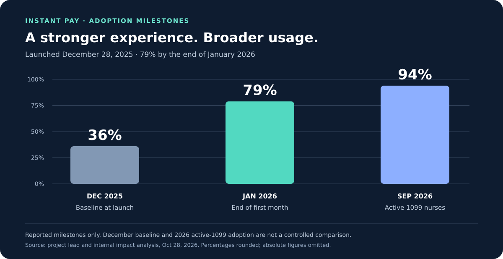

# Instant Pay: building around nurses

### From 36% usage at launch to 79% in the first month—and 94% by September

**Hector Cruz · Product management case study · ESHYFT**  
**Launch:** December 28, 2025 · **Focus:** customer discovery, vendor evaluation, product strategy, and product and system planning

Nurses wanted more control over when and how they accessed their earnings. I led the Instant Pay initiative from understanding those needs and evaluating payment providers through defining the in-app experience and the operational requirements behind it. The result brought setup, available earnings, cash-out, and payment history into the ESHYFT app.

*Three reported milestones, not a continuous monthly series. Launch: December 28, 2025. January and September adoption are measured among active 1099 nurses; the December baseline reflects the earlier product's usage at launch. See [measurement notes](docs/measurement-notes.md) for definitions and limits.*

| At a glance | |
| --- | --- |
| **Customer problem** | Fragmented setup, payout restrictions, and limited visibility into available earnings |
| **My ownership** | Client and nurse discovery, vendor evaluation, product strategy, and product and system requirements |
| **Collaboration** | Engineering, Design, Finance, and Support |
| **Key decision** | Let nurse needs define the requirements, then evaluate vendors against the intended experience |
| **Reported outcome** | **+43 percentage points** from the December baseline to January; **+58 points** by September |

> **Public disclosure:** Selected percentages and relative changes are shared here. Absolute nurse counts, transaction counts, payment volumes, and monetary amounts are omitted to protect confidential business information.

## Why the earlier experience needed to change

ESHYFT connects nursing professionals with facilities that need shifts filled. Its earlier Pay On Demand service, delivered through Fingercheck, already offered access to earnings, but nurses encountered payout restrictions, fragmented setup, and limited visibility inside the ESHYFT app.

The product opportunity was to give nurses a clearer view of available pay and greater control over accessing it. The business question was whether an experience built around those needs would earn substantially greater usage.

## Discovery: customer needs became the requirements

We listened to clients and nurses, including through a user survey. Feedback raised approval delays, payout caps, and requests for direct deposit. The recurring need was control: understanding what earnings were available and accessing them through a journey that fit how nurses worked.

The alternatives we reviewed did not provide the combination our nurses were asking for. That finding shaped the product direction and the criteria I used to evaluate vendors.

| What we heard or observed | Product response | What the vendor and system evaluation needed to address |
| --- | --- | --- |
| Fragmented setup | Bring setup and payout methods into the ESHYFT journey | Integration fit and the provider's onboarding capabilities |
| Limited visibility into available pay | Show withdrawable earnings in Wallet | Clear ownership of eligibility, balances, and holds |
| Approval delays and payout restrictions | Define access rules around how nurses worked | Payout capabilities, limits, and timecard dependencies |
| Requests for direct deposit | Evaluate payout destinations as part of the experience | Supported payout methods and operational fit |

**My guiding belief: if we built the best experience for our nurses, they would use it.**

## The decision: evaluate vendors against the experience

I evaluated the existing Fingercheck experience alongside alternatives including Branch and Stripe. The evaluation covered the nurse journey, payout capabilities, integration effort, and fit with payroll and reconciliation. It helped determine which capabilities a provider could supply and which ESHYFT needed to build.

The resulting operating model uses **Stripe for payouts**, while **ESHYFT manages the Instant Pay ledger, balances, eligibility, limits, and support visibility**.

That division put responsibility on ESHYFT to define and maintain the rules behind the experience. Product planning therefore had to address changed timecards, deductions, payment failures, and reconciliation alongside the cash-out screens.

## What we built

I led product and system planning across the nurse experience and the processes supporting it, working with Engineering, Design, Finance, and Support.

| Area | What the implementation addressed |
| --- | --- |
| **Setup and Wallet** | Contextual entry points, payout methods, available earnings, cash-out, and payment history in the nurse app |
| **Payment requests** | Payout requests, fee visibility, and payment status |
| **Eligibility and balances** | Eligible earnings, holds, restrictions, and balance changes after corrected or rejected timecards |
| **Payroll** | Original W-2 tax and deduction requirements, plus accounting for early withdrawals in regular payroll |
| **Operations** | Payout reporting, deduction exports, reconciliation, and failed-payment review |

### Before and after

| Journey | Earlier Pay On Demand | New Instant Pay experience |
| --- | --- | --- |
| Get set up | Fragmented setup | Setup incorporated into the ESHYFT journey |
| Understand available pay | Limited in-app visibility | Wallet shows earnings available for withdrawal |
| Request payment | Provider-led experience with restrictions raised in discovery | In-app request with fee and payment status |
| Track payments | Information spread across the earlier experience | Wallet payment history and operational visibility |

## Managing the risks

A clear cash-out experience depended on consistent rules underneath it. The original requirements addressed five risks:

- **Incorrect available pay:** distinguish total earnings from withdrawable funds, accounting for eligibility, deductions, tax calculations, and holds.
- **Changed timecards:** define balance handling after corrections or rejection, including when earnings had already been withdrawn.
- **Duplicate payment:** account for early withdrawals and deductions in regular payroll.
- **Payment problems:** define statuses, failed-payment review, and support visibility.
- **Reconciliation gaps:** connect earnings, the Instant Pay ledger, and provider payout records through reporting.

## Impact: rapid adoption after launch

Instant Pay launched on **December 28, 2025**, with a **36% December usage baseline**. By the **end of January 2026**, usage reached **79%**, a **43-percentage-point increase in the first month after launch**. By **September 2026**, adoption reached **94% of active 1099 nurses**—**58 percentage points above the December baseline**.

The reported usage progression supports the original product hypothesis: an experience shaped around nurse needs could achieve much broader use. The baseline and later observations span a W-2-to-1099 transition, so they should not be treated as a controlled comparison.

### Supporting engagement and retention signals

Monthly hours worked per 1099 nurse increased **approximately 29% from January to September**. In a cohort of nurses whose first paid week fell between December 28, 2025 and March 31, 2026, Instant Pay users also showed higher observed retention:

| Segment | Still active in the September–October follow-up |
| --- | ---: |
| Regular users: used Instant Pay in at least half of worked weeks | **36%** |
| Occasional users: used it in fewer than half of worked weeks | **45%** |
| Never used Instant Pay | **16%** |

Users were approximately **2–3 times as likely to remain active** in that follow-up period. This is an association; it does not establish that Instant Pay caused greater retention. Occasional users had the highest retention, and the groups may differ in tenure, work history, and motivation. The broader classification transition and market growth also limit attribution.

[Read the measurement definitions and limitations →](docs/measurement-notes.md)

## What I learned

**Discovery can shape the operating model.** Listening to nurses changed the requirements we brought to vendors and the capabilities we needed to build ourselves.

**Vendor evaluation is product strategy.** A provider's value depends on how well it supports the intended customer journey and the teams responsible for delivering it.

**Payment UX depends on less visible systems.** Eligibility, balances, deductions, and reconciliation were essential to making the experience work.

## What I'd do next

I would investigate setup completion, first cash-out, repeat use, and payment-related support contacts to identify the remaining friction. I would also build on the retention analysis by accounting for nurse tenure, work history, and the W-2-to-1099 transition before drawing stronger conclusions about causality.

---

*This portfolio case study focuses on the original implementation and launch, with subsequent adoption results. It describes my product leadership and collaboration; implementation was a team effort.*
